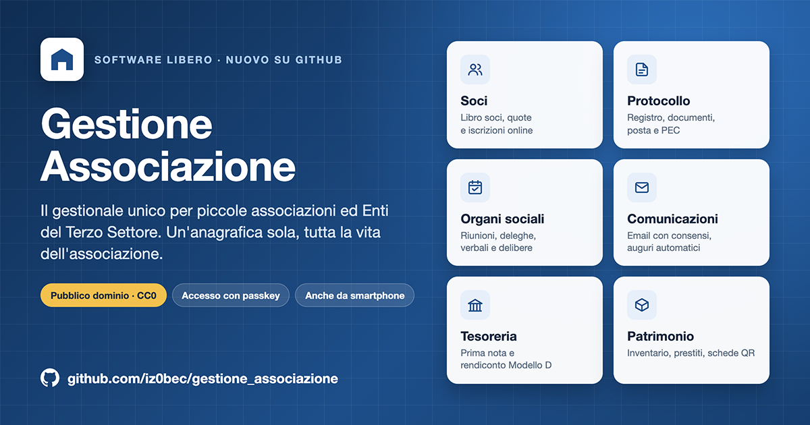

<!--
******************************************************
* Progetto:    Gestione Associazione
* Autore:      Bartolomeo Santoro aka IZ0BEC
* Email:       info@iz0bec.info
* Descrizione: Presentazione del progetto
* Licenza:     CC0 1.0 Universal (pubblico dominio)
* SPDX-License-Identifier: CC0-1.0
******************************************************
-->
<p align="center">
  
</p>

# Gestione Associazione

Gestionale unico per associazioni ed Enti del Terzo Settore di piccole dimensioni:
anagrafica, soci e tesseramento, protocollo, organi sociali e verbali, comunicazioni,
tesoreria e patrimonio in un'unica applicazione web.

Nasce dall'unione di tre applicazioni usate da una sezione ANCR (Associazione Nazionale
Combattenti e Reduci): **Protocollo ANCR**, **Gestione Soci** e **Gestione Assemblee**.
L'analisi di partenza è in [docs/analisi/analisi-e-finalita.md](docs/analisi/analisi-e-finalita.md).

> **Stato**: versione stabile `1.0.4`. Installazione su server Debian/Ubuntu o in
> un container LXC su Proxmox: vedi [Installazione](docs/sistema/installazione.md).
> Moduli disponibili: accesso con secondo fattore, ruoli, dati dell'organizzazione,
> registro attività, **anagrafica unica**, **soci e tesseramento** (libro soci, quote,
> ricevute, domande di iscrizione anche online), **protocollo** (registro, documenti,
> posta e PEC da protocollare, registri giornalieri), **organi sociali** (cariche,
> riunioni, presenze e deleghe, verbali e delibere), **comunicazioni e anniversari**
> (email con consensi, compleanni, onomastici, ricorrenze, anzianità, auguri automatici),
> **tesoreria** (prima nota, quote, rendiconto per cassa Modello D) e **patrimonio**
> (inventario, prestiti, schede pubbliche con QR, passaggio di consegne). Gli altri moduli sono pianificati nella
> [roadmap](docs/roadmap.md).

## Caratteristiche

- **Un'anagrafica per tutto**: la stessa persona è socio, mittente di un protocollo,
  partecipante a un'assemblea, senza archivi da riallineare.
- **Registri affidabili**: numerazioni annuali senza duplicati né buchi, registro
  delle attività non modificabile, storia delle modifiche di ogni scheda.
- **Sicurezza curata**: secondo fattore (app di autenticazione o passkey), blocco dei
  tentativi ripetuti, ruoli e permessi per funzione, Content Security Policy rigorosa,
  allegati mai pubblici. Vedi [Sicurezza](docs/sistema/sicurezza.md).
- **Interfaccia semplice**: ricerca istantanea, tema chiaro/scuro, utilizzabile da
  smartphone; nessuna risorsa caricata da Internet.
- **Privacy**: consensi per finalità con data e modalità, esportazioni registrate.

## Tecnologie

Python 3.13 · Django 6.1 · PostgreSQL 15+ · HTMX · Tabler (Bootstrap 5) · WeasyPrint ·
django-allauth (MFA, passkey) · django-axes. Le motivazioni sono nel
[registro delle decisioni](docs/architettura/decisioni.md).

## Avvio rapido (sviluppo)

```bash
git clone <repository> gestione_associazione && cd gestione_associazione
uv sync                                        # dipendenze (https://docs.astral.sh/uv/)
docker compose -f compose.dev.yaml up -d      # PostgreSQL di sviluppo sulla porta 55432
cp .env.example .env                           # poi: SECRET_KEY, DATABASE_URL, DEBUG=true
uv run python manage.py migrate
uv run python manage.py createsuperuser
uv run python manage.py runserver
```

Dettagli in [Sviluppo](docs/sistema/sviluppo.md). Per l'installazione in produzione:
[Installazione](docs/sistema/installazione.md).

## Documentazione

| | |
|---|---|
| **Manuale operativo** (per chi usa l'applicazione) | [docs/operativo/](docs/operativo/README.md) |
| **Manuale operativo in PDF**, con le immagini (dati di esempio) | [docs/manuale/manuale-operativo.pdf](docs/manuale/manuale-operativo.pdf) |
| **Manuale di sistema** (installazione, configurazione, sicurezza, backup) | [docs/sistema/](docs/sistema/README.md) |
| Analisi e finalità | [docs/analisi/analisi-e-finalita.md](docs/analisi/analisi-e-finalita.md) |
| Decisioni di architettura | [docs/architettura/decisioni.md](docs/architettura/decisioni.md) |
| Roadmap | [docs/roadmap.md](docs/roadmap.md) |
| Novità per versione | [CHANGELOG.md](CHANGELOG.md) |

## Licenza

Il codice e la documentazione di questo progetto sono dedicati al **pubblico dominio**
con [CC0 1.0 Universal](LICENSE): chiunque può copiarli, modificarli, distribuirli e usarli,
anche a fini commerciali, senza chiedere permesso.

Le librerie di terze parti incluse o usate mantengono le proprie licenze
([elenco](docs/sistema/licenze-terze-parti.md)).

## Autore

Bartolomeo Santoro aka IZ0BEC · <info@iz0bec.info>
